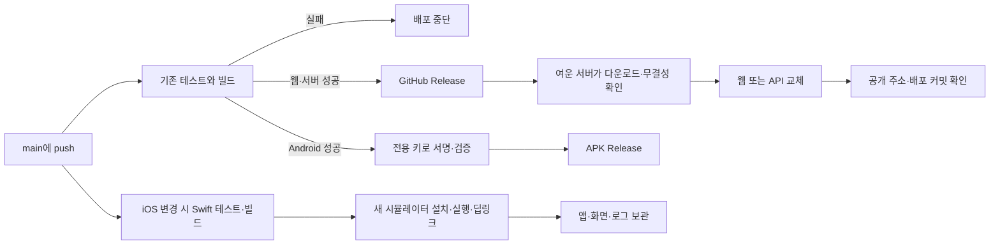

# 여운 CI/CD 적용·검증 기록

2026-11-08 KST. 대상: `tarobo22/taro-raect`, `taro-back`, `taro`와 기존 여운 전용 Lightsail. 딜러허브의 코드·인프라·도메인·DB는 변경하지 않았다.

## 실제 운영 흐름

웹과 API는 서로 다른 저장소에서 배포하며, DB 볼륨과 GPT 환경파일은 유지한다. 기존 이력을 지우지 않고 `main`으로 fast-forward했다. force push는 사용하지 않았다.

## 확인한 결과

| 대상 | 확인 결과 | 실행 근거 |
|---|---|---|
| 웹 | 기존 테스트 170개·타입·빌드·릴리스 검사 4개 통과. 실제 서버에 `d28adf9` 반영 | [Actions](https://github.com/tarobo22/taro-raect/actions/runs/42409125816) |
| FastAPI | 기존 테스트 618개·마이그레이션·OpenAPI·신규 배포 검사 12개·Docker 빌드 통과. 실제 서버에 `77cb0ab` 반영 | [Actions](https://github.com/tarobo22/taro-back/actions/runs/42409121115) |
| Android | 기존 동작 테스트 173개·네이티브 6개·JS 번들·APK 빌드·전용 서명 검증 통과. `19330d9` APK 공개 | [Actions](https://github.com/tarobo22/taro/actions/runs/42409129822) |
| iOS | Swift 6개·Xcode 서명 빌드·키체인 identity·새 시뮬레이터 설치·5초 뒤 실행 확인·딥링크 통과. `0b7199a` 화면 캡처에서 여운 홈 확인 | [Actions](https://github.com/tarobo22/taro/actions/runs/42408932006) |

공개 `/api/health`에서 PostgreSQL 연결을 확인했고, 상담 기능 설정에서 `available=true`, 카드 장수 `[1, 3, 5]`를 확인했다. 웹의 실제 JavaScript 파일도 HTTP 200으로 내려받았다.

iOS의 `launch.png`를 직접 열어 연결 오류 화면 대신 여운 홈·공간 선택·마음 이야기 시작 버튼이 표시되는 것을 확인했다. 실행 파일에는 Xcode가 생성한 시뮬레이터용 application-identifier가 있었고, 실제 설치된 실행 파일 경로와 PID가 일치했다. 앱 ZIP·화면·로그는 해당 Actions의 `ios-simulator-proof` artifact에 7일간 보관된다. iOS 검증 커밋 이후 모바일 변경은 Android 게시 조건과 문서뿐이며 iOS 소스는 같다.

공개 APK를 인증 없이 다시 내려받아 릴리스의 SHA-256과 일치함을 확인했다. 크기는 99,830,614 bytes, SHA-256은 `e32b8d7163eebd842d0708ad6a7d1e5d579974de8bd24403e6c59814b391b3ee`다. 다운로드한 APK도 로컬 `apksigner`로 Signature Scheme v2·v3를 검증했다. RSA 4096 전용 서명자 1명이며, 앞선 `0d1e35c`와 최종 `19330d9` 릴리스의 인증서 SHA-256이 같았다. 이 기록은 빌드·서명·다운로드 검증이며 Android 실기기 UI 검증을 의미하지 않는다.

자동 배포된 API `6727eb5`에서 합성 사연 한 건으로 실제 GPT 상담을 수동 확인했다. “다음 주 첫 면접을 앞두고 긴장이 돼요. 준비한 내용을 차분하게 말하고 싶어요.”를 전송한 결과, 작업이 `succeeded`, 상담 단계가 `advice`로 완료됐고 카드 3장과 조언을 반환했다. 전송부터 완료 확인까지 12.34초였다. 이후 커밋은 배포 스크립트·검사·문서만 변경했고 상담 구현은 동일하다. 단일 동작 확인이며 평균·p95 성능 측정이나 품질 점수로 해석하지 않는다. 게스트 토큰과 GPT 키는 기록하지 않았다.

매번 실행되는 CI에서는 유료 GPT 호출을 하지 않는다. [최초 공개 배포의 화면 검증](lightsail-demo-20261108.md)도 별도로 남겨 두었다. 부하 테스트는 하지 않았다.

## 이번에 고친 실행 오류

| 문제 | 원인·수정 | 재검증 |
|---|---|---|
| Android SDK 도구 탐색 실패 | 실행기 PATH 대신 `ANDROID_HOME` 아래 설치 경로를 지정 | SDK 준비 단계 통과 |
| 릴리스 manifest 생성 실패 | 정수인 파일 크기를 함수처럼 호출한 오류 수정 | 먼저 재현 테스트를 실패시킨 뒤 수정해 통과. 웹·서버 실제 배포 성공 |
| iOS 첫 화면 연결 실패 | 프로세스는 실행됐지만 캡처에서 연결 오류 확인. 네이티브 API 주소가 localhost였고 unsigned 빌드에 시뮬레이터 키체인 identity가 없었음 | 공개 API와 Xcode의 시뮬레이터 서명을 사용하고, 실제 실행 파일의 identity를 검사 |
| iOS 권한 정보 읽기 실패 | `codesign` 기본 출력이 plist가 아닌 텍스트였음 | 해당 오류는 `--xml`로 수정. 최종본에서는 시뮬레이터의 실제 권한 저장 위치인 Mach-O에서 읽음 |
| iOS 수동 서명 후 실행 거절 | 기기용 권한을 수동 서명에 넣은 앱이 `Taskgated Invalid Signature`로 종료 | 수동 재서명 대신 Xcode 기본 시뮬레이터 빌드 사용. 권한은 Mach-O의 `__TEXT,__entitlements`에서 확인 |
| APK 릴리스 HTTP 403 | 빌드 중 `main`의 workflow가 갱신돼 이전 커밋의 릴리스 생성을 GitHub가 거절 | 세 저장소 모두 현재 `main` 대조. 오래된 빌드는 공개하지 않고 artifact 보관. 최신 커밋에서 다시 게시 |
| 문서 커밋과 진행 중인 배포 충돌 | 문서는 새 CI를 시작하지 않으므로 단순 SHA 비교는 정상 코드의 게시도 막을 수 있음 | 코드 차이가 없는 문서 변경만 허용. 별도 회귀 검사로 정상 게시 확인 |

참고: [Apple 권한 정보 추출](https://developer.apple.com/documentation/technotes/tn3125-inside-code-signing-provisioning-profiles), [시뮬레이터 권한 저장 위치](https://github.com/bazelbuild/rules_apple/blob/main/doc/common_info.md#codesign-bundles-for-the-simulator-appleskip_codesign_simulator_bundles), [GitHub 릴리스 생성 권한](https://docs.github.com/en/rest/releases/releases#create-a-release).

새 배포 검사에서는 다른 저장소/커밋, 손상 파일, 압축 경로 이탈, 링크로 인한 파일 노출, 진입 파일 누락을 거절하는지 확인했다. 기존 제품 테스트·fixture·mock·snapshot은 수정하지 않았다. CI 실행 설정은 요청한 자동화를 위해 변경했다. 이전 로그를 지우거나 실패를 성공처럼 바꾸지 않았다.

## 배포 범위와 남은 연결

- 웹·API: 기존 월 US$7 여운 서버에 자동 배포. 새 AWS 유료 자원 없음.
- 서버 배포 에이전트·Compose·Caddy 설정 변경은 별도 설치 대상. 앱 코드 push가 AWS 인프라 변경을 실행하지 않음.
- Android: 전용 서명키를 승인받은 GitHub Secret에 저장. APK 직접 배포 방식.
- iOS: 시뮬레이터 앱·로그·스크린샷까지 보관. Apple 배포 인증서가 없어 TestFlight/App Store 업로드는 하지 않음.
- Play Store 업로드 및 OTA(CodePush 대체) 자동 배포는 연결하지 않음. 기존 서버 OTA 설정은 꺼진 상태 유지.
- GPT·DB·SSH 키는 GitHub에 저장하지 않음. 서버 환경파일 권한 `0600`, root 소유 확인.
- 단일 서버 API 교체에는 짧은 중단 가능. DB 자동 롤백은 하지 않으며, 호환되는 마이그레이션을 전제로 함.

## 사용 링크

- [웹에서 바로 사용](https://yeoun-43-201-209-249.sslip.io/)
- [현재 배포 커밋 확인](https://yeoun-43-201-209-249.sslip.io/deployment-status.json)
- [서명된 Android APK 다운로드](https://github.com/tarobo22/taro/releases/latest/download/yeoun-demo.apk)
- [검증한 APK 릴리스](https://github.com/tarobo22/taro/releases/tag/android-19330d949c653c56cb56d3d92aee575d12f0e0ce-42409129822-1)
- [CI/CD 운영 방법](ci-cd.md)

실제 변경 파일

### taro-back

- `.github/workflows/checks.yml`
- `.dockerignore`
- `deploy/lightsail/Caddyfile`
- `deploy/lightsail/Dockerfile`
- `deploy/lightsail/compose.yaml`
- `deploy/lightsail/install-ci.sh`
- `deploy/lightsail/publish_release.py`
- `deploy/lightsail/pull_release.py`
- `deploy/lightsail/test_publish_release.py` (신규)
- `deploy/lightsail/test_pull_release.py` (신규)
- `deploy/lightsail/wait_deployed.py`
- `deploy/lightsail/yeoun-deploy.service`
- `deploy/lightsail/yeoun-deploy.timer`
- `deploy/lightsail/README.md`
- `docs/deployment/ci-cd.md`
- `docs/deployment/ci-cd-verification-20261108.md`

### taro-raect

- `.github/workflows/checks.yml`
- `deploy/publish_release.py`
- `deploy/test_publish_release.py` (신규)
- `deploy/wait_deployed.py`
- `docs/ci-cd.md`

### taro

- `.github/workflows/checks.yml`
- `.github/workflows/ios.yml`
- `scripts/configure-demo.mjs`
- `scripts/prepare-ios-simulator.sh`
- `docs/ci-cd.md`

로컬 실행 보조 파일은 Git에서 제외된 `.local`에 두었다: 서버 전송 helper 수정, actionlint 설치, 전용 서명키 생성·GitHub Secret 업로드 helper. 실제 키 값과 서명 파일은 커밋하지 않았다. 앱 화면·카피·업무 기능 코드는 변경하지 않았다.

