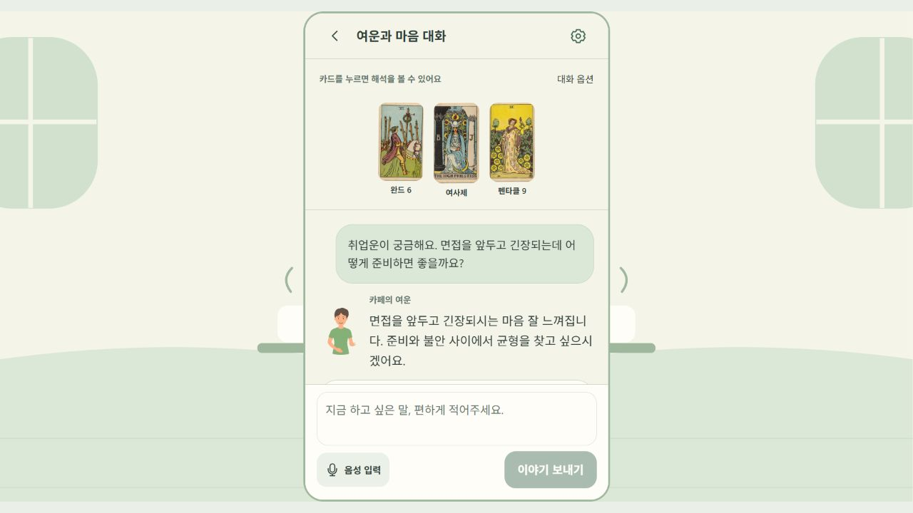

# 여운 공개 데모 배포 완료

**[여운 바로 사용하기](https://yeoun-43-201-209-249.sslip.io/)** · 2026-11-08 검증

별도 가입 없이 게스트로 시작합니다. 홈에서 **타로 AI와 이야기하기 → 고민 입력 → 이야기 보내기**를 누르면 실제 GPT 상담과 카드가 표시됩니다.

[인쇄용 SVG QR](assets/yeoun-demo-qr.svg) · [PNG QR](assets/yeoun-demo-qr.png)

## 배포한 것

| 항목 | 실제 구성 |
|---|---|
| AWS | 서울 `ap-northeast-2`, 여운 전용 Lightsail |
| 플랜 | `micro_3_0` · 1 GB RAM · 40 GB SSD · 공인 IPv4 포함 · 월 US$7 |
| 자원 | `yeoun-demo-20261108-server`, `yeoun-demo-20261108-ip` |
| 웹 | React 정적 빌드, 소스 `2806cdb` |
| 서버 | FastAPI, 소스 `f399f56` + 이 저장소의 배포 구성 |
| 데이터 | 신규 PostgreSQL 17 · Docker 영구 볼륨 |
| GPT | OpenAI 실제 API · `gpt-5-mini` · 상담 worker 1개 |
| HTTPS | Caddy · Let's Encrypt 인증서 발급 완료, 자동 갱신 설정 |
| 주소 | 고정 IP `43.201.209.249`에 연결된 무료 sslip.io 주소 |
| 서비스 재시작 | Docker 자동 시작 및 컨테이너 `unless-stopped` 설정 |

딜러허브 EC2·DB·도메인·배포 구성은 변경하지 않았습니다. 기존 상담·개인정보 데이터도 복사하지 않았습니다.

## 실제 확인 결과

| 확인 | 결과 |
|---|---|
| 웹 배포 빌드 | 성공 |
| CloudFormation | cfn-lint 통과, Change Set은 여운 자원 2개 추가만 포함, `CREATE_COMPLETE` |
| Docker 구성·DB | Compose 설정 검사 통과, SQL 마이그레이션 20개 적용 |
| 외부 HTTPS | 웹·`/api/health`·`/api/v2/health` 모두 HTTP 200 |
| 실제 GPT 연결 | `/api/v2/counseling/capabilities`의 `available=true` 및 실제 답변 수신 확인 |
| 공개 화면 사용 | 게스트 자동 진입 → 상담 요청 → GPT 답변 → 카드 3장 표시 확인 |
| 공개 범위 | 80·443 공개, SSH는 관리 PC 1개 IP만 허용, API·DB 포트는 비공개 |
| 키 보관 | 서버 root 전용 환경파일 0600. Git·프론트 번들·보고서에 키 없음 |

실제 검증에 사용한 **가상 사연**: “취업운이 궁금해요. 면접을 앞두고 긴장되는데 어떻게 준비하면 좋을까요?”

실제 응답 일부: “면접을 앞두고 긴장되시는 마음 잘 느껴집니다. 준비와 불안 사이에서 균형을 찾고 싶으시겠어요.”

이어서 준비를 작은 과제로 나누는 조언과 오늘 할 행동이 표시됐고, 완드 6·여사제·펜타클 9가 공개 화면에 나왔습니다. 이 결과는 연결·동작 확인 1건이며 품질 점수나 부하 성능 검증을 의미하지 않습니다.

## 비용과 운영 범위

- 월 **US$7는 서버 플랜 요금**입니다. GPT 사용료·세금·기본 제공량을 넘는 전송은 별도입니다. 별도 RDS·ALB·NAT·유료 도메인은 만들지 않았습니다.
- 기존 AI 제한: 사용자당 하루 20회, 전체 하루 200회. 호출당 금액 상한을 보장하는 설정은 아닙니다.
- 소규모 이력서 시연용 단일 서버입니다. 고가용성·외부 백업·부하 테스트는 이번 범위에 포함되지 않습니다. cfn-guard 별도 규칙 검사는 도구가 없어 실행하지 않았습니다.
- 무료 DNS는 sslip.io 서비스에 의존합니다. 전용 고정 IP를 유지하는 동안 QR 주소를 그대로 사용할 수 있습니다.
- 앱 기능·화면·기존 테스트 파일은 변경하지 않았습니다. 배포 구성과 QR·확인 기록만 추가했습니다.

구성 및 재배포 방법: [배포 README](../../deploy/lightsail/README.md)

기반 문서: [AWS Lightsail 요금](https://aws.amazon.com/lightsail/pricing/) · [CloudFormation Lightsail](https://docs.aws.amazon.com/AWSCloudFormation/latest/TemplateReference/aws-resource-lightsail-instance.html) · [Caddy HTTPS](https://caddyserver.com/docs/automatic-https) · [sslip.io 주소·인증서 안내](https://nip.io/)
