# 실제 PostgreSQL FK ERD

46개 테이블·323컬럼·53FK를 information_schema/pg_constraint에서 추출했다. 사용자 행은 읽지 않았다. 간선은 실제 FK만 표시한다. mandatory/optional은 child nullability, max1/many는 키 제약으로만 판단하며 업무상의 최소 개수는 추정하지 않는다.

```mermaid
erDiagram
  %% Metadata only from isolated final test DB; no application rows exported.
  admin_audit {
    uuid id PK "not null"
    uuid actor_owner_id FK "nullable"
    text action "not null"
    text target_type "not null"
    text target_id "not null"
    jsonb details "not null"
    timestamptz created_at "not null"
  }
  admin_catalog_heads {
    text code PK "not null"
    uuid publication_id FK "nullable"
    int4 version "not null"
  }
  admin_catalog_publications {
    uuid id PK "not null"
    uuid version_id FK "not null"
    text code "not null"
    text action "not null"
    uuid previous_id FK "nullable"
    jsonb snapshot "not null"
    timestamptz created_at "not null"
  }
  admin_catalog_versions {
    uuid version_id PK "not null"
    jsonb snapshot "not null"
    text snapshot_hash "not null"
    text rights_status "not null"
    text review_note "not null"
    int4 review_version "not null"
  }
  admin_feedback_triage {
    uuid feedback_id PK,FK "not null"
    text status "not null"
    int4 version "not null"
  }
  admin_ota_policy {
    int4 singleton PK "not null"
    text channel "not null"
    text min_native_version "not null"
    bool updates_enabled "not null"
    int4 version "not null"
  }
  admin_roles {
    uuid owner_id PK,FK "not null"
    text role "not null"
    timestamptz updated_at "not null"
  }
  admin_sessions {
    uuid id PK "not null"
    uuid owner_id FK "not null"
    text token_hash UK "not null"
    uuid source_session_id FK "not null"
    text role "not null"
    timestamptz expires_at "not null"
  }
  ai_consent_events {
    uuid id PK "not null"
    uuid owner_id FK "not null"
    text kind "not null"
    text policy_version "not null"
    bool granted "not null"
    timestamptz occurred_at "not null"
  }
  ai_conversation_turns {
    uuid id PK "not null"
    uuid owner_id FK "not null"
    uuid conversation_id FK,UK "not null"
    uuid client_message_id UK "not null"
    text fingerprint "not null"
    int4 turn_index UK "not null"
    text text "not null"
    jsonb answers "not null"
    text input_source "not null"
    text state "not null"
    jsonb assistant_result "nullable"
    int4 version "not null"
    timestamptz created_at "not null"
  }
  ai_conversations {
    uuid id PK "not null"
    uuid owner_id FK "not null"
    text topic "not null"
    text tone "not null"
    text state "not null"
    int4 version "not null"
    timestamptz created_at "not null"
    timestamptz updated_at "not null"
  }
  ai_usage_attempts {
    uuid id PK "not null"
    uuid session_id FK "not null"
    uuid request_id "not null"
    timestamptz created_at "not null"
  }
  app_sessions {
    uuid id PK "not null"
    text token_hash UK "not null"
    timestamptz created_at "not null"
    timestamptz expires_at "not null"
    timestamptz last_seen_at "not null"
    text platform "not null"
  }
  billing_receipts {
    text token_hash PK "not null"
    uuid owner_id FK "not null"
    text product_id "not null"
    text product_kind "not null"
    text entitlement_key "not null"
    text token_ciphertext "not null"
    text state "not null"
    timestamptz expires_at "nullable"
    bool acknowledged "not null"
    timestamptz verified_at "not null"
  }
  counsel_sessions {
    uuid id PK "not null"
    uuid session_id FK "not null"
    text topic "not null"
    text question "not null"
    jsonb answers "not null"
    text tone "not null"
    jsonb advice "not null"
    timestamptz created_at "not null"
    uuid parent_id FK "nullable"
  }
  daily_readings {
    uuid session_id PK,FK "not null"
    date day PK "not null"
    text topic PK "not null"
    jsonb result "not null"
    uuid id "not null"
    timestamptz created_at "not null"
  }
  data_privacy_feedback {
    uuid id PK "not null"
    uuid owner_id FK,UK "not null"
    uuid reading_id "nullable"
    uuid turn_id "nullable"
    text rating "not null"
    text reason "not null"
    text comment "not null"
    text idempotency_hash UK "not null"
    text fingerprint "not null"
    timestamptz created_at "not null"
  }
  data_privacy_profiles {
    uuid owner_id PK,FK "not null"
    text locale "not null"
    text timezone "not null"
    text tone "not null"
    bool reduced_motion "not null"
    text voice_mode "not null"
    text state "not null"
    timestamptz updated_at "not null"
  }
  data_privacy_requests {
    uuid id PK "not null"
    uuid owner_id FK,UK "nullable"
    text kind "not null"
    text state "not null"
    text idempotency_hash UK "nullable"
    text fingerprint "nullable"
    text receipt_hash UK "not null"
    bytea export_bytes "nullable"
    timestamptz expires_at "not null"
    timestamptz created_at "not null"
    timestamptz updated_at "not null"
    bytea receipt_salt "nullable"
  }
  experience_ai_jobs {
    uuid session_id PK,FK "not null"
    uuid request_id PK "not null"
    text fingerprint "not null"
    uuid lease_id "not null"
    timestamptz lease_until "not null"
    text state "not null"
  }
  experience_operations {
    uuid session_id PK,FK "not null"
    text kind PK "not null"
    uuid request_id PK "not null"
    text fingerprint "not null"
    jsonb result "not null"
    timestamptz created_at "not null"
  }
  favorites {
    uuid owner_id PK,FK "not null"
    uuid reading_id PK,FK "not null"
    timestamptz created_at "not null"
  }
  journal_create_requests {
    uuid session_id PK,FK "not null"
    uuid request_id PK "not null"
    text fingerprint "not null"
    jsonb result "not null"
    timestamptz created_at "not null"
  }
  journal_entries {
    uuid id PK "not null"
    uuid session_id FK "not null"
    date day "not null"
    text mood "not null"
    text body "not null"
    timestamptz created_at "not null"
    timestamptz updated_at "not null"
    int4 version "not null"
  }
  journal_insights {
    uuid id PK "not null"
    uuid owner_id FK "not null"
    date range_start "not null"
    date range_end "not null"
    text state "not null"
    int4 based_on_count "not null"
    jsonb result "nullable"
    uuid consent_event_id "not null"
    uuid context_consent_id "not null"
    int4 version "not null"
    timestamptz created_at "not null"
  }
  journal_v2_create_requests {
    uuid owner_id PK,FK "not null"
    text key_hash PK "not null"
    text fingerprint "nullable"
    uuid entry_id FK "nullable"
    timestamptz created_at "not null"
    timestamptz expires_at "not null"
  }
  journal_v2_deleted_entries {
    uuid owner_id PK,FK "not null"
    uuid entry_id PK "not null"
    timestamptz deleted_at "not null"
  }
  journal_v2_sources {
    uuid entry_id PK,FK "not null"
    uuid owner_id FK "not null"
    uuid source_reading_id "nullable"
    uuid source_turn_id "nullable"
  }
  p0_ai_context_sources {
    uuid job_id PK,FK "not null"
    uuid entry_id PK "not null"
    int4 entry_version "not null"
  }
  p0_ai_idempotency {
    uuid owner_id PK,FK "not null"
    text scope PK "not null"
    uuid key PK "not null"
    text fingerprint "not null"
    uuid resource_id "not null"
    jsonb response "not null"
    timestamptz expires_at "not null"
  }
  p0_ai_jobs {
    uuid id PK "not null"
    uuid owner_id FK "not null"
    text kind "not null"
    text state "not null"
    uuid resource_id "not null"
    int4 resource_version "not null"
    uuid conversation_id FK "nullable"
    uuid consent_event_id "nullable"
    uuid context_consent_id "nullable"
    jsonb payload "not null"
    int4 version "not null"
    uuid lease_id "nullable"
    timestamptz lease_until "nullable"
    bool provider_started "not null"
    text error_code "nullable"
    text result_url "nullable"
    timestamptz created_at "not null"
    timestamptz finished_at "nullable"
  }
  p0_ai_runs {
    uuid id PK "not null"
    uuid job_id FK "not null"
    text model_id "nullable"
    text prompt_version "not null"
    text schema_version "not null"
    text request_id "nullable"
    text response_id "nullable"
    int4 input_tokens "nullable"
    int4 output_tokens "nullable"
    int4 elapsed_ms "nullable"
    timestamptz created_at "not null"
  }
  p0_ai_transcriptions {
    uuid id PK "not null"
    uuid owner_id FK "not null"
    text state "not null"
    text transcript "nullable"
    text audio_path "nullable"
    text mime_type "not null"
    int4 duration_ms "not null"
    int4 version "not null"
    timestamptz expires_at "not null"
    timestamptz created_at "not null"
  }
  p0_ai_usage_attempts {
    uuid id PK "not null"
    uuid owner_id FK "nullable"
    timestamptz created_at "not null"
  }
  p0_daily_draws {
    uuid owner_id PK,FK "not null"
    date local_day PK "not null"
    text topic PK "not null"
    int4 card_id "not null"
    uuid deck_version_id "not null"
    text captured_timezone "not null"
    timestamptz expires_at "not null"
  }
  p0_reading_commands {
    uuid owner_id PK,FK "not null"
    text scope PK "not null"
    uuid key PK "not null"
    text fingerprint "not null"
    uuid reading_id "not null"
    timestamptz expires_at "not null"
  }
  p0_readings {
    uuid id PK "not null"
    uuid owner_id FK "not null"
    text kind "not null"
    text topic "not null"
    text question "not null"
    uuid deck_version_id "not null"
    date local_day "nullable"
    text captured_timezone "not null"
    text state "not null"
    int4 version "not null"
    jsonb private_slots "not null"
    jsonb selected_cards "not null"
    jsonb result "nullable"
    timestamptz created_at "not null"
  }
  p1_favorite_create_requests {
    uuid owner_id PK,FK "not null"
    text key_hash PK "not null"
    text fingerprint "not null"
    uuid reading_id FK "nullable"
    timestamptz favorite_created_at "not null"
  }
  p1_journal_insight_sources {
    uuid insight_id PK,FK,UK "not null"
    uuid entry_id PK "not null"
    int4 entry_version "not null"
    int4 position UK "not null"
  }
  social_accounts {
    uuid owner_id PK,FK "not null"
    timestamptz created_at "not null"
  }
  social_auth_flows {
    uuid id PK "not null"
    uuid owner_id FK "not null"
    text provider "not null"
    text state_hash UK "not null"
    text nonce "nullable"
    text provider_verifier "nullable"
    text client_challenge "not null"
    text return_uri "not null"
    text platform "not null"
    text intent "not null"
    text state "not null"
    timestamptz expires_at "not null"
    text ticket_hash UK "nullable"
    text subject_hash "nullable"
  }
  social_device_sessions {
    uuid id PK "not null"
    uuid owner_id FK "not null"
    text token_hash UK "not null"
    text platform "not null"
    timestamptz created_at "not null"
    timestamptz expires_at "not null"
    timestamptz revoked_at "nullable"
  }
  social_identities {
    text provider PK,UK "not null"
    text subject_hash PK "not null"
    uuid owner_id FK,UK "not null"
    timestamptz created_at "not null"
  }
  story_requests {
    uuid owner_id PK,FK "not null"
    text key_hash PK "not null"
    text fingerprint "not null"
    uuid result_run_id FK "not null"
  }
  story_runs {
    uuid id PK,UK "not null"
    uuid owner_id FK,UK "not null"
    int8 run_sequence "not null"
    text episode_id "not null"
    text episode_version "not null"
    text state "not null"
    int4 version "not null"
    text current_node_id "nullable"
    text ending_id "nullable"
    jsonb history "not null"
    timestamptz created_at "not null"
    timestamptz updated_at "not null"
    timestamptz completed_at "nullable"
  }
  tarot_readings {
    uuid id PK "not null"
    uuid session_id FK "not null"
    text topic "not null"
    text question "not null"
    _int4 card_ids "not null"
    jsonb result "not null"
    timestamptz created_at "not null"
  }
  app_sessions |o--o{ admin_audit : "actor_owner_id"
  admin_catalog_publications |o--o{ admin_catalog_heads : "publication_id"
  admin_catalog_publications |o--o{ admin_catalog_publications : "previous_id"
  admin_catalog_versions ||--o{ admin_catalog_publications : "version_id"
  data_privacy_feedback ||--o| admin_feedback_triage : "feedback_id"
  app_sessions ||--o| admin_roles : "owner_id"
  app_sessions ||--o{ admin_sessions : "owner_id"
  social_device_sessions ||--o{ admin_sessions : "source_session_id"
  app_sessions ||--o{ ai_consent_events : "owner_id"
  ai_conversations ||--o{ ai_conversation_turns : "conversation_id"
  app_sessions ||--o{ ai_conversation_turns : "owner_id"
  app_sessions ||--o{ ai_conversations : "owner_id"
  app_sessions ||--o{ ai_usage_attempts : "session_id"
  app_sessions ||--o{ billing_receipts : "owner_id"
  counsel_sessions |o--o{ counsel_sessions : "parent_id"
  app_sessions ||--o{ counsel_sessions : "session_id"
  app_sessions ||--o{ daily_readings : "session_id"
  app_sessions ||--o{ data_privacy_feedback : "owner_id"
  app_sessions ||--o| data_privacy_profiles : "owner_id"
  app_sessions |o--o{ data_privacy_requests : "owner_id"
  app_sessions ||--o{ experience_ai_jobs : "session_id"
  app_sessions ||--o{ experience_operations : "session_id"
  app_sessions ||--o{ favorites : "owner_id"
  p0_readings ||--o| favorites : "owner_id,reading_id"
  app_sessions ||--o{ journal_create_requests : "session_id"
  app_sessions ||--o{ journal_entries : "session_id"
  app_sessions ||--o{ journal_insights : "owner_id"
  journal_entries |o--o{ journal_v2_create_requests : "entry_id"
  app_sessions ||--o{ journal_v2_create_requests : "owner_id"
  app_sessions ||--o{ journal_v2_deleted_entries : "owner_id"
  journal_entries ||--o| journal_v2_sources : "entry_id"
  app_sessions ||--o{ journal_v2_sources : "owner_id"
  p0_ai_jobs ||--o{ p0_ai_context_sources : "job_id"
  app_sessions ||--o{ p0_ai_idempotency : "owner_id"
  ai_conversations |o--o{ p0_ai_jobs : "conversation_id"
  app_sessions ||--o{ p0_ai_jobs : "owner_id"
  p0_ai_jobs ||--o{ p0_ai_runs : "job_id"
  app_sessions ||--o{ p0_ai_transcriptions : "owner_id"
  app_sessions |o--o{ p0_ai_usage_attempts : "owner_id"
  app_sessions ||--o{ p0_daily_draws : "owner_id"
  app_sessions ||--o{ p0_reading_commands : "owner_id"
  app_sessions ||--o{ p0_readings : "owner_id"
  app_sessions ||--o{ p1_favorite_create_requests : "owner_id"
  p0_readings |o--o{ p1_favorite_create_requests : "reading_id"
  journal_insights ||--o{ p1_journal_insight_sources : "insight_id"
  app_sessions ||--o| social_accounts : "owner_id"
  app_sessions ||--o{ social_auth_flows : "owner_id"
  app_sessions ||--o{ social_device_sessions : "owner_id"
  social_accounts ||--o{ social_identities : "owner_id"
  app_sessions ||--o{ story_requests : "owner_id"
  story_runs ||--o{ story_requests : "owner_id,result_run_id"
  app_sessions ||--o{ story_runs : "owner_id"
  app_sessions ||--o{ tarot_readings : "session_id"
```

